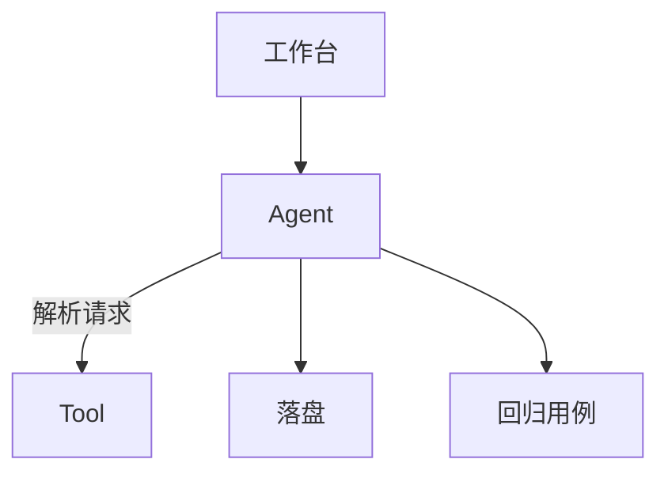
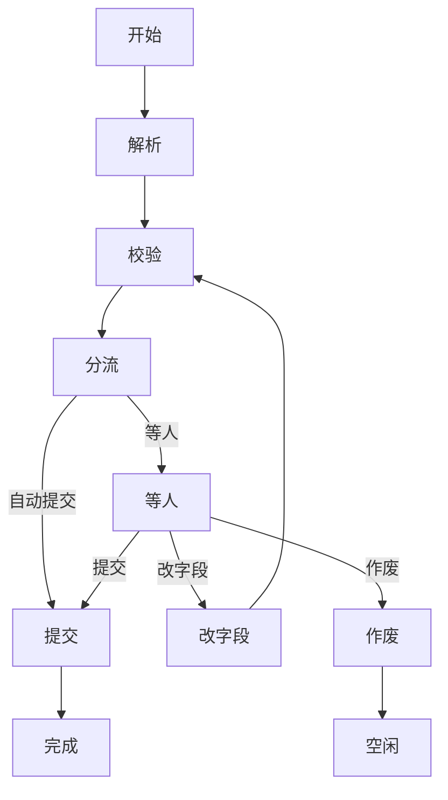

# 现场演示文稿：架构 · 核心逻辑 · 准确率方案

> 对应试题「架构设计图、核心逻辑说明、准确率提升方案」。可口述或拆成 PPT。

---

## 1. 架构设计图

### 1.1 部署与模块



Agent 管会话与人机；Tool 管解析与校验。提交写入落盘；人工改过再提交的，写入回归用例。

### 1.2 订舱会话



- 纯通过且开了自动提交 → 直接提交；否则等人（改字段后再校验，或提交 / 作废）。
- 完成后状态为「完成」。底栏自然语言改已存盘字段在**图外**（指令修正），不重新走进本图。

### 1.3 工程边界

试题要求说明「确定与 LLM 概率的工程边界，冲突如何处理」。先分清各自干什么，再定冲突听谁的：

| 侧 | 做什么 |
|----|--------|
| LLM（概率） | 读版面、抽字段、理解自然语言指令（结果可错） |
| 确定性 | Schema / 业务规则裁决能不能过；策略决定能不能自动提交 |
| 人工 | 等人时改表确认；必要时强制提交（应急） |

冲突时：**确定性规则 > 人工确认 > LLM**。模型不得编造压过规则；规则与业务意图冲突时由人裁决。

强制提交是**应急出口**：规则误拦或规则有 bug、业务上仍须入库时，由人确认后带问题落盘；不是模型自行放行，也不是日常主路径。

---

## 2. 核心逻辑说明

先 **Tool**（无会话，一次解析+校验），再 **Agent**（会话、人机、提交）。

### 2.1 Tool

目标：这张 PDF 抽成什么样、能不能过规则；一次请求返回结果，不管会话、不问人、不落盘。


| 做 | 不做 |
|----|------|
| 解析 + 校验一次齐套 | 不管会话、不问人、不写落盘 |
| 规则挡错；缺字段不编造 | 不负责自动提交 / 指令修正 |
| 可被 Agent 或外部单独调用 | — |

口播：*「Tool 只回答抽成什么样、能不能过；过不过看校验结论。」*

### 2.2 Agent

#### 主路径

1. 上传 PDF → 开票 → 解析（调 Tool）→ 吃进结果。
2. 分流：不通过 / 低置信 / 有警告 → 等人；纯通过且自动提交 → 提交 → 完成。
3. 等人时可改字段再校验，或提交 / 作废。
4. 提交写入落盘；若人工改过字段，同时写入回归用例。

#### 人机

| 场景 | 行为 |
|------|------|
| 不通过 / 低置信 | 不瞎补全；等人改或作废 |
| 仅警告 | 等人确认；不自动提交 |
| 纯通过 | 默认真人点提交；可开自动提交 |
| 完成后改数 | 底栏自然语言 → 指令修正 → 先验后写；不通过不落盘 |

#### 指令修正（图外）

```text
完成态：「把毛重单位从 KGS 换成 TON」
  → 文本模型 Function Calling
  → 改存盘字段 → 再校验 → 仅通过才写入
```

录入中以表单为主；文字修正留给提交后来不及手改的场景。

### 2.3 分层治理

| 层 | 主要落在 | 要点 |
|----|----------|------|
| 输入标准化 | Tool | PDF→页图/文本；字段规整 |
| 结构化输出 | Tool | Schema / JSON 约束 |
| 业务规则 | Tool | 港口、重量、白名单等 |
| 人机 + 置信度 | Agent | 低置信等人；报告指引 |
| 持续评估 | 两边资产 | 金标评测；修正写入回归用例 |

**参考文档（已实现用例）**：[test_cases.md](test_cases.md) — 按上表五层列出 pytest / 金标 / 评测脚本；跑法见文内「怎么跑」。

模块与流程细节：[module_design.md](module_design.md)、[flow_design.md](flow_design.md)、[booking_parse_summary.md](booking_parse_summary.md)。

---

## 3. 准确率提升方案

> 不靠单次 LLM 碰运气，而是 **金标评测 + 规则闸门 + 人工兜底 + 回归用例**。  
> 模型读版面，规则定能不能过，人守边界；改对过的单变成回归用例。

### 3.1 怎么量

| 项 | 做法 |
|----|------|
| 金标 | 与样例 PDF 对齐的 gold（见 [data/gold/README.md](../data/gold/README.md)） |
| 评测 | `scripts/eval_accuracy.py`；基线见 [eval_baseline.md](eval_baseline.md) |
| 当前基线 | 场景通过 `5/5`；字段准确率 `1.0` |
| 指标 | 字段级匹配；规则场景结论是否符合预期 |
| 用例清单 | [test_cases.md](test_cases.md) |

### 3.2 提准手段

1. **标签与 Prompt**：样例字段对齐；少样本字段说明。
2. **保版面**：优先页图 / 整份 PDF，避免纯文本毁掉表格关系。
3. **规则挡错**：规整 + Schema + 业务规则，不靠模型自律。
4. **人机 + 回归**：低置信必人工；人工改后再提交的写入回归用例，防准确率回退。

详见 [booking_parse_summary.md](booking_parse_summary.md)、[flow_design.md](flow_design.md)、[eval_baseline.md](eval_baseline.md)、[test_cases.md](test_cases.md)。
