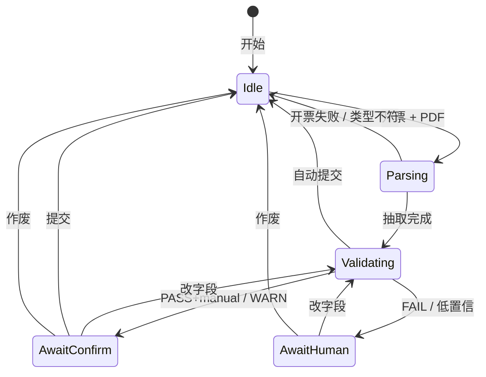
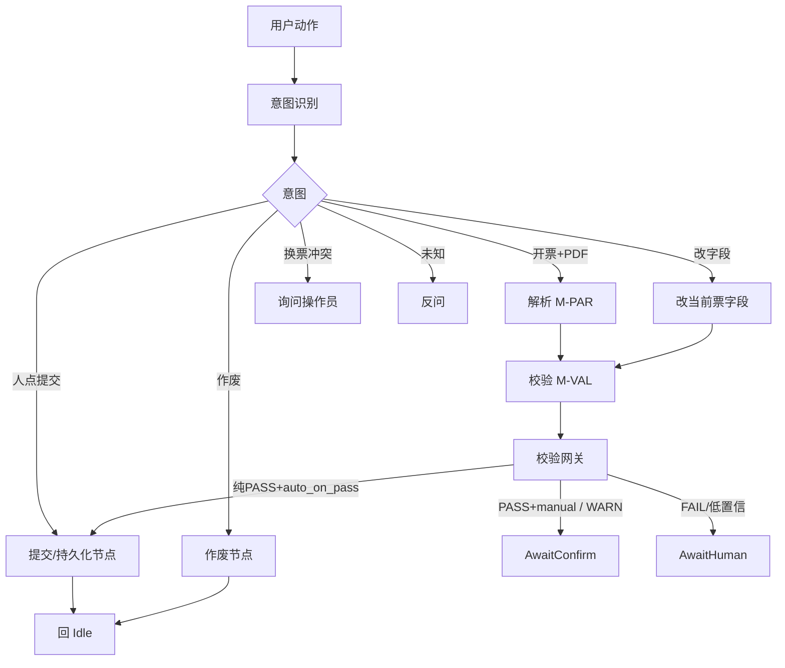

# 流程设计（初版）

目的：先以 **Use Case** 固定「谁要干什么」，再推导状态机与节点流。  
静态模块见 `docs/module_design.md`。需求对照：`AGT-*`、`VAL-*`、`ADV-01`、`AGT-06` 等。

---

## 1. Use Case 清单（流程推导起点）

主角色：**操作员**。系统：**单证录入智能体（工作台 + 后端）**。

| 编号 | Use Case | 目标 | 优先级 | 主成功路径（摘要） |
| --- | --- | --- | --- | --- |
| UC-01 | 录入一票托运单并完成 | 从 PDF 到入库完成 | P0 | 上传 → 解析校验 →（默认核对后提交；`auto_on_pass` 时纯 PASS 可自动提交） |
| UC-02 | 校验失败后修正再提交 | FAIL/低置信时改对再过 | P0 | 查看报告 → 改字段 → 再校验 → 提交或作废 |
| UC-03 | 带警告确认提交 | 仅 WARN 时人工确认放行 | P0 | 查看 WARN → 确认提交（**不可**自动提交） |
| UC-04 | 作废当前票 | 放弃本票，回到可开新票 | P0 | 作废 → Idle |
| UC-05 | 连续录入下一票 | 一票结束后开新票 | P0 | Idle → 再上传（同 UC-01） |
| UC-06 | 未结束时换新 PDF | 避免覆盖当前票 | P0 | 系统询问 → 提交/放弃开新/取消 |
| UC-07 | 拒收非法或非单证文件 | 非 PDF / 非托运单不硬录入 | P0 | 明确失败提示，不建有效票 |
| UC-08 | 自然语言改已录入字段 | 如 KGS→TON | P2 | 录入中改字段 → 再校验 → 按提交策略分流 |
| UC-09 | 独立调用解析 API/Tool | 无会话只要三件套 | P1 | parse_booking → 返回 raw/validated/report（不经会话提交） |

| 项 | 说明 |
| --- | --- |
| 前置 | 操作员已打开工作台；样例/PDF 可用 |
| 后置（成功） | 一票已提交（人工或自动）或已作废；或 API 已返回三件套 |
| 业务规则 | 不编造；规则 > 人工 > LLM；同时仅一票进行中 |
| **提交策略（AGT-06）** | 配置项：`manual`（**默认**）/ `auto_on_pass`。见 §3.1 |

---

## 2. Use Case → 流程推导关系

| Use Case | 推导出的流程要素 |
| --- | --- |
| UC-01 | 状态机主路径；`manual`→AwaitConfirm；`auto_on_pass`+纯 PASS→直接 Idle |
| UC-02 | AwaitHuman、再进 Validating |
| UC-03 | AwaitConfirm（WARN 永远进人确认） |
| UC-04 | 作废 → Idle |
| UC-05 | Idle → Parsing → Validating |
| UC-06 | 非 Idle 收到 PDF 的冲突询问 |
| UC-07 | 接入拒 PDF；解析拒非单证 |
| UC-08 | 改字段 → Validating（与首次同一状态）→ 网关 |
| UC-09 | 无会话 M-GW：解析→校验 |

组织顺序：**Use Case → 提交策略 → 会话状态 → Agent 节点 → 界面主路径 → 分支明细**。

---

## 3. 提交策略（影响状态迁移）

| 配置值 | 行为 |
| --- | --- |
| `manual`（默认） | 任意 PASS / WARN 都进 `AwaitConfirm`，须人点提交或作废 |
| `auto_on_pass` | **仅当**无 FAIL、无 WARN、且置信度达标（纯 PASS）→ 自动提交并回 `Idle`；WARN/FAIL 仍须人工 |

| 校验结果 | `manual` | `auto_on_pass` |
| --- | --- | --- |
| 纯 PASS | AwaitConfirm | **自动提交 → Idle** |
| 仅 WARN | AwaitConfirm | AwaitConfirm（不可自动） |
| FAIL / 低置信 | AwaitHuman | AwaitHuman |

---

## 4. 单据会话状态机（支撑 UC-01～06）

同时仅一票「进行中」。

画法：`[*]` 置顶 → `Idle` → `Parsing`（抽）→ `Validating`（验）→ 待确认/待人工；改字段后再进**同一个** `Validating`。  
**不设 `Revalidating`**：再校验与首次校验是同一过程态。  
**提交 / 作废 / 自动提交不是状态**，只是迁回 `Idle` 的边；落库在 Agent 提交节点（§5）。



| 层（从上到下） | 内容 |
| --- | --- |
| 顶 | `[*]` 开始 → `Idle` |
| ① | `Parsing`：抽字段（过程态） |
| ② | `Validating`：跑校验（首次与改字段后**共用**） |
| ③ | `AwaitConfirm` / `AwaitHuman` |
| 边（非状态） | 提交 / 作废 / 自动提交 / 开票失败 → 回 `Idle` |

| 规则 | 说明 | Use Case |
| --- | --- | --- |
| 开始 | Idle → Parsing → Validating | UC-01 |
| 再验 | Await* → Validating（同一状态） | UC-02、UC-08 |
| 回家 | 提交/作废/失败/自动提交 → Idle | UC-01、UC-03、UC-04 |
| 新单 | 必须先在 Idle | UC-05 |
| 冲突 | 非 Idle 又来新 PDF → 先询问 | UC-06 |

---

## 5. Agent 节点流（支撑 UC-01～08 的一次动作）

**意图识别 → 工具调用 → 校验网关 →（人工或自动提交）**。意图与工具分节点。



| 节点 | 模块 | 主要 Use Case |
| --- | --- | --- |
| 意图识别 | M-AGT | 全部会话类 UC |
| 工具: 解析 | M-PAR | UC-01、UC-05、UC-07 |
| 工具: 校验 | M-VAL | UC-01、UC-02、UC-08 |
| 工具: 改字段 | M-AGT | UC-02、UC-08 |
| 校验网关 | M-AGT | 读 report + 提交策略分流 |
| **提交/持久化** | M-AGT | 人点提交与 `auto_on_pass` **共用**；写库后回 Idle |
| 作废 | M-AGT | UC-04 |
| 待确认 / 人工兜底 | M-FE + M-AGT | UC-01～03 |

UC-09：不经会话状态机；M-GW 内解析 → 校验，直接返回三件套（无「提交」语义）。

---

## 6. 操作员主路径（UC-01 界面视角）

同一工作台页面。

| 步骤 | 操作员 | 系统 | Use Case |
| --- | --- | --- | --- |
| 1 开票 | 上传 PDF | 解析 → 校验 → 网关（含策略） | UC-01 |
| 2a 自动完成 | （可只读提示已自动提交） | `auto_on_pass` 且纯 PASS → Idle | UC-01 |
| 2b 核对 | 查看字段与报告 | PASS+manual 或 WARN | UC-01、UC-03 |
| 3a 确认 | 提交 | → Idle | UC-01、UC-03 |
| 3b 修正 | 改字段 / 自然语言改数 | 再进 Validating → 网关 | UC-02、UC-08 |
| 3c 作废 | 放弃 | → Idle | UC-04 |
| 4 新单 | 再上传 | 同步骤 1 | UC-05 |

```text
上传 → [Parsing] → [Validating] → 网关判断提交策略
                    ├─ auto_on_pass + 纯 PASS ──► 自动提交 → Idle
                    ├─ 核对（结果+报告）
                    │     ├─ 提交 ──► Idle
                    │     ├─ 修改 ──► Validating ──► 网关
                    │     └─ 作废 ──► Idle
                    └─ AwaitHuman（FAIL）──► 改/作废
```

---

## 7. 分支与异常（按 Use Case）

| 编号 | 场景 | 系统行为 | Use Case |
| --- | --- | --- | --- |
| F-01 | 不是合法 PDF | 接入拒绝；不建票 | UC-07 |
| F-02 | 不是托运/订舱单 | 明确失败，不硬抽字段 | UC-07 |
| F-03 | 校验 FAIL | AwaitHuman；改后重验或作废；不自动补全 | UC-02 |
| F-04 | 仅 WARN | AwaitConfirm；须人确认；**绝不**走自动提交 | UC-03 |
| F-05 | 进行中又上传新 PDF | 询问：提交 / 放弃开新 / 取消 | UC-06 |
| F-06 | Idle 时动态改数 | 反问先开票 | UC-08 边界 |
| F-07 | 录入中动态改单位 | 改字段 → Validating → 网关（可自动提交） | UC-08 |
| F-08 | 规则与 LLM 冲突 | 以规则为准 | UC-01/02 |
| F-09 | 纯 PASS + `auto_on_pass` | 自动提交 → Idle，可给操作员成功提示 | UC-01 |
| F-10 | 纯 PASS + `manual` | AwaitConfirm，须人点提交 | UC-01 |

---

## 8. 解析 → 校验 细链路（UC-01 / UC-09 工具内部）

```text
M-GW: PDF 格式校验
  → M-PAR: 类型识别 → 规整 → LLM 抽取 → raw
  → M-VAL: 结构检查 → 业务规则（M-MD）→ 汇总 → validated + report
  → M-OBS: 日志等（横切）
```

会话路径下，出校验后进入 **校验网关（含提交策略）**；UC-09 仅返回三件套。

| 阶段 | 失败时 | Use Case |
| --- | --- | --- |
| PDF 格式 | 直接错误 | UC-07 |
| 类型识别 | 短路径失败 | UC-07 |
| 抽取/校验 | report → 网关分流 | UC-01、UC-02 |

---

## 9. 与模块、需求的对应

| 要素 | 模块 | 需求 | Use Case |
| --- | --- | --- | --- |
| 用例清单 | — | 背景+核心 | UC-01～09 |
| 提交策略 | M-AGT | AGT-06 | UC-01、UC-03 |
| 会话状态机 | M-AGT、M-FE | AGT-05、AGT-06 | UC-01～06 |
| Agent 节点 | M-AGT、M-PAR、M-VAL | AGT-01～04 | UC-01～08 |
| 主路径同页 | M-FE | BG-03 | UC-01 |
| 再校验 | M-VAL | ADV-01 | UC-02、UC-08 |
| 独立 API | M-GW | API-* | UC-09 |

---

## 10. 修订记录

| 日期 | 说明 |
| --- | --- |
| 2026-10-12 | 初版：状态机、Agent、主路径、分支 |
| 2026-10-12 | 补 Use Case 清单，并以其推导后续流程 |
| 2026-10-12 | 纳入提交策略：状态机/网关/主路径支持 `manual` 与 `auto_on_pass` |
| 2026-10-12 | 状态机改布局：Idle 为外层「家」，进行中为内层复合态；Agent 明确提交/持久化节点 |
| 2026-10-12 | 取消 Revalidating；拆出 Parsing + Validating，再校验复用 Validating |
